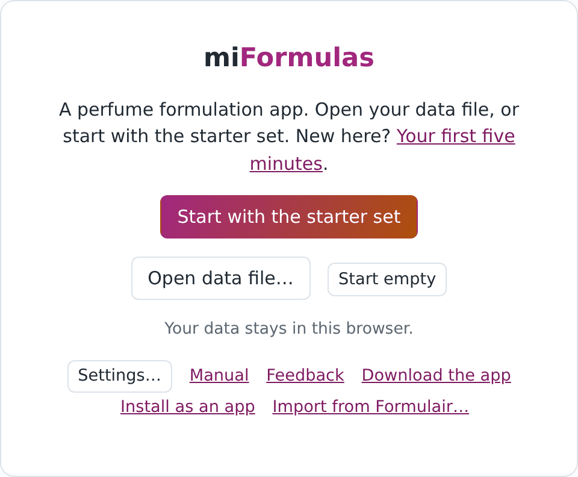
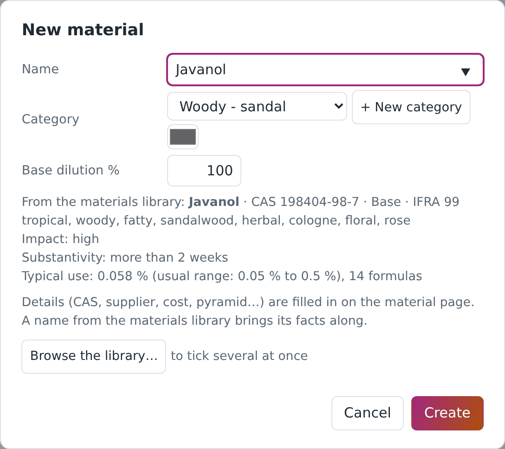
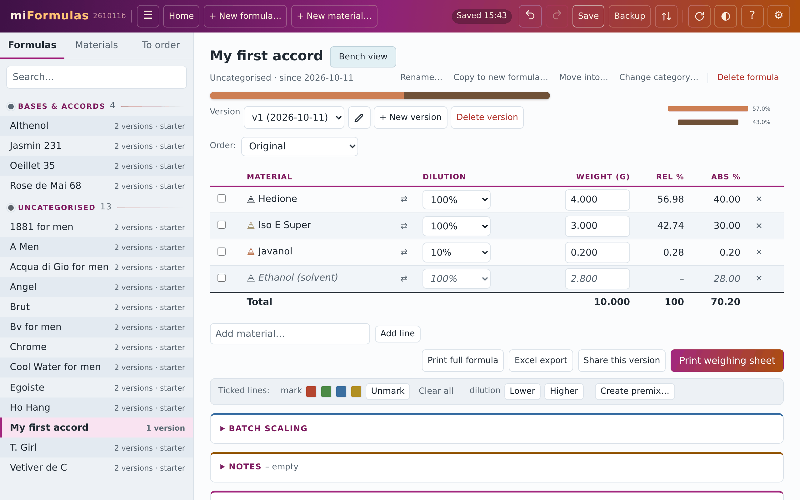
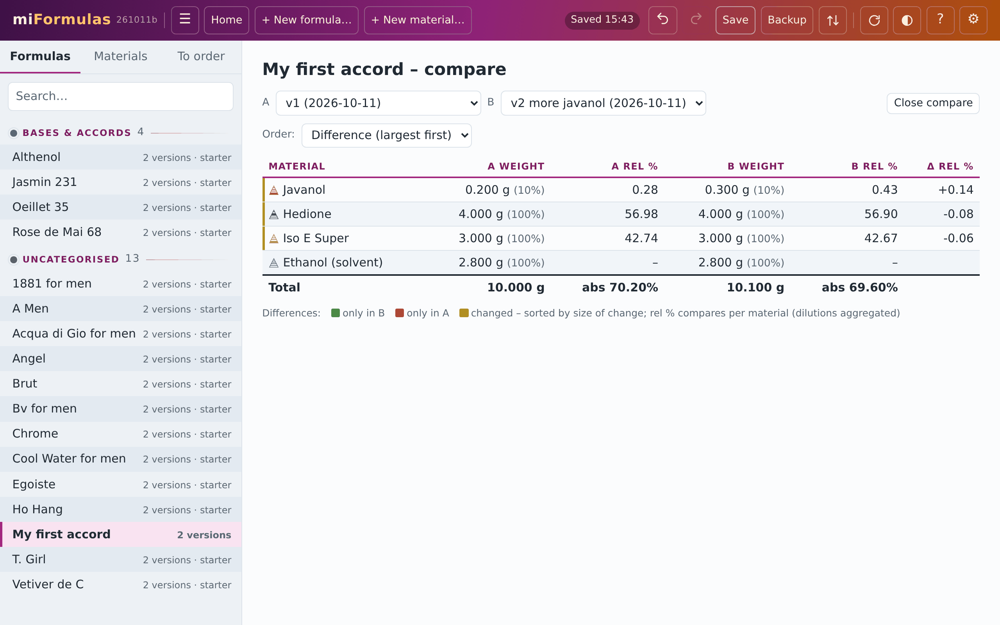

# Your first five minutes with miFormulas

Three things are worth doing first: make a material, make a formula with it, and make a second version of that formula. One small example runs through all three, and it takes about five minutes. The [manual](manual.html) is the reference behind every step.

## Before you start (1 minute)

miFormulas runs in Chrome or Edge, in one of three ways. Choose one before you start:

- **On the site.** Open https://miformulas.com. Your work stays in that browser, on that device.
- **As an app of its own.** Open https://miformulas.com and click **Install as an app** on the start screen (on an iPhone or iPad, Safari's **Add to Home Screen** does the same): the site in a window of its own, with its own icon, and it updates by itself. As on the site, your work stays in the browser (section [15](manual.html#s15-install-as-an-app-with-its-own-icon)).
- **As a file on your own PC or Mac**, working offline. Open https://miformulas.com, click **Download the app** on the start screen, give `miFormulas.html` a folder of its own and open it there in Chrome or Edge. When you click **Start with the starter set** there, the app explains that it will create your data file and the browser asks where to save it: choose the folder of `miFormulas.html` and keep the name `miformulas-data.json`. **Check for updates** in its Settings brings the next version (section [14](manual.html#s14-where-your-data-lives-and-the-other-ways-in)).

Then click **Start with the starter set**: sixteen formulas and nearly two hundred materials to look at; each is marked "starter" so you'll be able to tell them apart from your own.

Next, open Settings (⚙ in the header) and click **Get the latest library**. The materials library is a reference list the app uses to retrieve data about the materials you want to add to your inventory. It adds nothing to the inventory, but a material you create from it arrives with its facts.

## 1. A material (1 minute)

A material is anything you weigh. Click **+ New material…** in the header (on a phone: on the Welcome page, under Start here) and type `Javanol`. The name is in the library, so the window shows what the material will arrive with: its CAS number, pyramid level, IFRA limit and a few odour facts, and it chooses the category. Click **Create**.

The material page opens, and everything on it can be changed. You also keep a 10 % dilution of Javanol: type 10 in the field under the dilutions and click **Add dilution**. A formula offers a material only at the dilutions you have added. Price, supplier and stock are on the same page, for when you need them (section [3](manual.html#s3-materials)).

## 2. A formula (2 minutes)

Click **+ New formula…** (in the header, or on a phone under Start here on the Welcome page), name it `My first accord` and click **Create**. Type a material in **Add material…** under the table and press Enter: the line appears with weight 0, and the cursor stays in **Add material…** for the next one. Add these four:

- Hedione
- Iso E Super
- Javanol
- Ethanol

In the Dilution column of Javanol, choose 10 %. Then select the 0.000 of the first weight and type 4. If you're using a physical keyboard, Tab will confirm it and move to the next material's weight, where you type 3, then 0.2 and 2.8; on a touch screen, tap each weight in turn. Every change is saved automatically, and Ctrl+Z (or the undo arrow in the header) will undo your latest entry (section [5](manual.html#s5-editing-a-formula)).

## 3. A version (1 minute)

Let's assume you made this batch and it needs more javanol. Instead of changing v1, you can click **+ New version**. The app copies the version into v2, and v1 stays as it was, frozen, the record of what you made. In v2, set Javanol to 0.3 g. The pencil next to the version list gives v2 a label, say `more javanol`, so that the list tells the versions apart. **Compare** puts two versions side by side and marks what changed (sections [4](manual.html#s4-formulas-and-versions) and [11](manual.html#s11-comparing-versions)).

## Where your work is, and where to go next

On the site, and in the app you installed from it, your work is kept in the browser, on this device. Click **Backup** in the header now and then: it writes a copy of everything, with the date and time in its name. In Chrome and Edge, **Save to a data file…** (on the Welcome page, and in Settings) moves your work into a file of your own, which the app then keeps saving to.

If you're using the downloaded app, it saves your work from the start in `miformulas-data.json`, the file you created next to `miFormulas.html` when you clicked **Start with the starter set** (sections [14](manual.html#s14-where-your-data-lives-and-the-other-ways-in) and [20](manual.html#s20-backups-and-recovery)).

From here, the manual takes over:

- the bench view, to build a batch group by group: section [10](manual.html#s10-bench-view-and-printing)
- batch scaling and premixes: section [8](manual.html#s8-batch-scaling-and-premixes)
- the IFRA check: section [12](manual.html#s12-ifra-check-and-category-panel)
- coming from Formulair: section [17](manual.html#s17-coming-from-formulair)
- a formula from a photo, a PDF or a spreadsheet, with your own AI assistant: the [AI prompts](ai-prompts.html)
